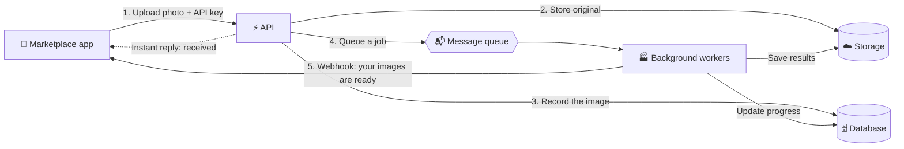

<div align="center">

# 🖼️ Mini Cloudinary

**An image-processing service that marketplaces and classifieds plug into with a single API key.**

Upload once. Get clean, consistent, safe images back, in every size you need.


</div>

---

## 📌 The problem

Anyone running an online shop, a classifieds site, or a rental marketplace knows the pain of user-uploaded photos:

- 📦 **Huge files** straight from a phone camera that slow every page down
- 📐 **Inconsistent sizes and formats**, so listings look messy
- 🔁 **Duplicates and stolen images**, with the same photo reused across many listings
- 🔒 **Hidden private data**, since photos carry GPS location and device details in their metadata
- 🚫 **Inappropriate or low-quality content** that reaches the public unchecked

Big tools like Cloudinary solve this, but they get expensive quickly. Small businesses usually end up with brittle scripts that break under load, or with no solution at all.

## 💡 The solution

Mini Cloudinary is a standalone service that sits between a marketplace and its users. The marketplace sends every uploaded photo to the service through one API call, and the service takes care of the rest, reliably and in the background, without slowing the upload down.

### What it does

| | Feature |
|---|---|
| ✅ | **Validates** uploads and rejects corrupt or unsupported files |
| 🔐 | **Strips private metadata** (GPS, device info) to protect users |
| 📏 | **Creates multiple variants** (thumbnail, card, full-size) in modern formats like WebP and AVIF |
| 🗜️ | **Compresses** images to cut page weight without visible quality loss |
| 💧 | **Adds watermarks** when the business wants them |
| 🔍 | **Detects duplicates** by recognizing images that look the same, even if resized or re-saved |
| ⚖️ | **Serves many businesses at once**, each with its own settings, quotas, and usage tracking |
| 🚦 | **Prioritizes paying customers**, so a bulk upload from one tenant never blocks another |
| 🔔 | **Notifies you when finished** through a webhook |

## 🔄 How it works

The key idea: **the upload is fast, and the heavy work happens in the background.**



### Step by step

1. **Upload.** A marketplace sends a photo to the API with its key. The API confirms the key, accepts the file, and replies immediately.
2. **Safe storage.** The original photo is saved to cloud storage, and a record is created in the database.
3. **Queued.** A job is placed on a queue. The user doesn't wait for processing.
4. **Processed in stages.** Background workers pick up the job and run the image through a series of steps: validate, clean metadata, resize, compress, watermark, and check for duplicates. Each stage is tracked, so a crash or retry never causes double work.
5. **Ready.** Finished variants are stored, the record is marked complete, and the marketplace gets a webhook notification with links to the results.

### Built for real-world conditions

- **Failures are expected.** Broken files are retried a few times, then set aside for review instead of blocking everything else.
- **Fairness.** Free and paid customers use separate lanes, so heavy users can't crowd out others.
- **No repeated work.** If the same job is delivered twice, it's recognized and skipped.

## 🧰 Technologies

| Tool | Role in the project |
|---|---|
| **FastAPI** | The public API: fast, typed, and self-documenting |
| **PostgreSQL** | The source of truth for tenants, images, variants, and processing progress |
| **RabbitMQ** | The message queue that connects the API to the background workers |
| **AWS S3** | Storage for original images and generated variants |
| **Pillow** | The image toolkit for resizing, converting, and cleaning |
| **SQLAlchemy + Alembic** | Database access and versioned schema migrations |
| **uv** | Fast Python dependency and environment management |

## 🗺️ Roadmap

- [x] **Step 1:** Project skeleton and service health checks
- [ ] **Step 2:** Database schema and migrations
- [ ] **Step 3:** Upload endpoint with API key authentication
- [ ] **Step 4:** First worker: validate, strip metadata, resize
- [ ] **Step 5:** Full pipeline: compress, WebP/AVIF, watermark, per-tenant presets
- [ ] **Step 6:** Retries, dead-letter handling, bad-file protection
- [ ] **Step 7:** Duplicate image detection
- [ ] **Step 8:** Priority lanes and per-tenant fairness
- [ ] **Step 9:** Quotas, usage metering, signed webhooks
- [ ] **Step 10:** Moderation, metrics, load testing

## 🚀 Getting started

**Requirements:** Python 3.12, [uv](https://docs.astral.sh/uv/), a local PostgreSQL, a local RabbitMQ, and an AWS S3 bucket.

```bash
# 1. Install dependencies
uv sync

# 2. Configure your environment
cp env_sample .env      # then fill in your own values

# 3. Run the API
uv run uvicorn app.main:app --reload
```

Then open:

- `http://localhost:8000/docs` for the interactive API docs
- `http://localhost:8000/health` to confirm Postgres, RabbitMQ, and storage are all connected

> **Note:** never commit your `.env` file. It contains your database password and AWS keys.

## 📄 License

To be decided.